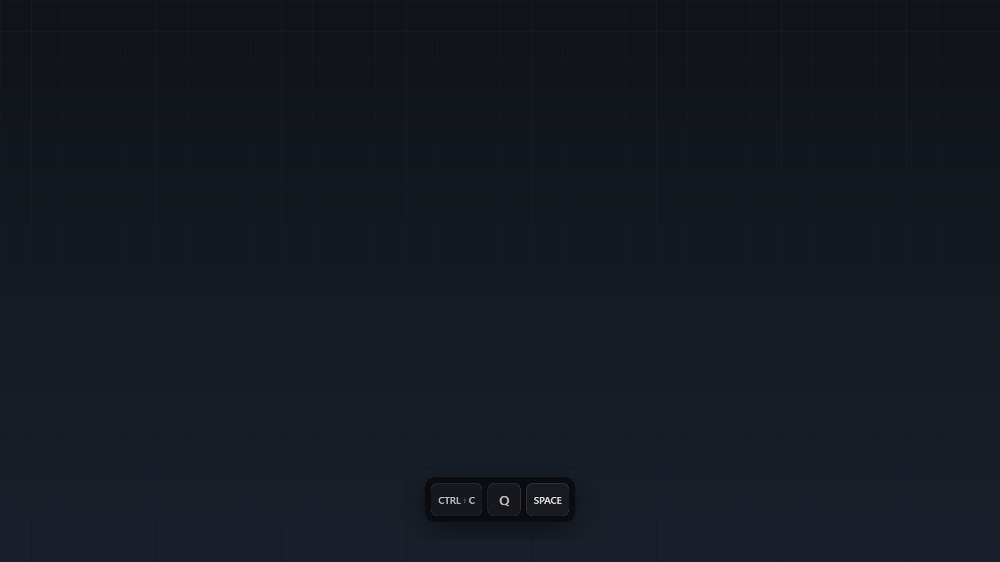

# obs-keyflow

> 在 OBS 录屏 / 直播画面上实时显示你正在按下的按键。Windows 本地运行，纯 Python 标准库，零第三方依赖。



*示意图：底部一条玻璃胶囊显示最近按键，组合键合并为 `CTRL+C` 形式；默认是未锁定的紧凑部件源，可直接用鼠标拖动。*

**English** — A local keystroke overlay for OBS Studio on Windows. A low-level keyboard hook
streams key events over Server-Sent Events; OBS renders them with a built-in Browser source.
No OBS plugin, no version ABI coupling, no telemetry, no third-party packages.

---

## 特性

- **只显示最近按下的键**：底部紧凑一条，最新的最亮、旧的略暗
- **鼠标直接拖拽定位**：默认生成紧凑部件源（未锁定），在 OBS 预览里按住就能拖到任意位置；键帽变多时自动缩放不溢出
- **也可参数化贴边**：`?anchor=` 九宫格 + `?margin=` 边距，适合固定版式；`?demo=1` 提供静态样张方便调位置
- **3 秒后自动淡出消失**：每枚键帽保持全亮 3 秒，最后约 0.45 秒淡出；全部消失时整条胶囊一起隐去，不按键时完全不占画面（时长与淡出长度可调，见参数表）
- **组合键合并**：`Ctrl+C` / `Ctrl+Shift+A`，`+` 号弱化显示；按住修饰键时同一枚键帽就地变成组合，不会多出一枚
- **按住高亮**：物理按住不放的键保持白色高亮，且按住期间不计入 3 秒倒计时
- **按键状态自愈**：每秒用 `GetAsyncKeyState` 校验收起的键是否还按着，丢失 keyup 也能自动纠正（切窗口、睡眠唤醒、远程桌面都不会卡住高亮）
- **单实例保护**：健康探针 + `SO_EXCLUSIVEADDRUSE`，重复启动（开机自启撞上手动启动）不会双钩子、不会抢端口
- **与 OBS 版本无关**：走浏览器源，不装任何插件，不受插件 ABI / OBS 升级影响
- **零第三方依赖**：仅 Python 标准库 + Win32 API
- **本地且最小暴露**：只监听 `127.0.0.1`，不联网、不落盘按键内容

## 快速开始

前置：**OBS Studio**（任意较新版本）＋ **Python 3.10+**。

```powershell
git clone <repo-url> obs-keyflow
cd obs-keyflow

# 1) 启动服务（前台可见日志；后台静默用 scripts\start.vbs）
python -m keyflow --console

# 2) 关闭 OBS 后，把浏览器源注入当前场景集合
python scripts/add-obs-source.py

# 3) 打开 OBS，场景里出现「按键显示」
```

可选：开机自动启动

```powershell
.\scripts\install-autostart.ps1      # 移除：.\scripts\install-autostart.ps1 -Remove
```

### 手动在 OBS 里加源（拖拽式，推荐）

来源 → `+` → **浏览器** → 关掉「本地文件」→ URL 填 `http://127.0.0.1:16900/?fit=1`，
宽 `880`、高 `160`（这是可拖动的框，内容会在框内自动居中/缩放），勾选「关闭源时关闭页面」。

加好后**不锁定**该源，就能在 OBS 预览里用鼠标直接拖它移动按键；想放哪儿就拖到哪儿。

## 两种定位方式

### 方式一：鼠标直接拖（直观，默认）

`add-obs-source.py` 默认就生成这种「紧凑部件源」：

- 源尺寸 = 可拖动的边框（默认 880×160），内容在框内居中，键帽变多时自动缩放，不会溢出
- 场景项 `locked: false`，在 OBS 预览里按住拖动即可移动，松手位置会随场景一起保存
- 需要精确位置时：在源属性的「变换」里看 `位置 X/Y`，或改用方式二

```powershell
python scripts/add-obs-source.py                    # 默认：底部居中、880×160 可拖部件
python scripts/add-obs-source.py --pos "1240,760"   # 指定初始位置
python scripts/add-obs-source.py --width 1000 --height 180
```

### 方式二：URL 参数精确贴边

`--full-canvas` 生成铺满画布的源，配合源内 `?anchor=` / `?margin=` 精确落位（适合固定版式、不想手动拖）：

```powershell
python scripts/add-obs-source.py --full-canvas --anchor br --margin 60
```

两种方式都改完记得在源属性里点「刷新页面」。

## 可调参数

改 OBS 源属性里的 URL 查询参数即可，改完点「刷新页面」：

| 参数 | 作用 | 默认 |
| --- | --- | --- |
| `?fit=1` | **部件模式**：内容在浏览器源框内居中并按需缩放，配合未锁定源可鼠标拖拽定位 | 关闭（=铺满画布） |
| `?n=5` | 显示最近几个按键（组合键算 1 个） | 5 |
| `?ttl=3000` | 键帽出现后多久消失（毫秒） | 3000（3 秒） |
| `?fade=450` | 消失前最后多久开始淡出（毫秒） | 450 |
| `?anchor=bc` | 吸附位置，九宫格：`tl` `tc` `tr` / `ml` `c` `mr` / `bl` `bc` `br`，也接受 `top-left`、`right`、`bottom`、`center` 等写法（`fit` 模式下不生效） | `bc`（底部居中） |
| `?margin=44` | 距吸附边缘的像素距离（`?bottom=` 保留为兼容写法，等价） | 44 |
| `?size=64` | 键帽尺寸 px | 64 |
| `?gap=10` | 键帽间距 px | 10 |
| `?reload=30` | 自动刷新缓存：每隔 N 分钟（仅在画面无键帽时）强制重载页面，0=关闭 | 0 |
| `?hold=60` | 兜底：单枚键帽最多保持"按住"多少秒后自动释放 | 60 |
| `?demo=1` | 静态样张：不按键也常驻几枚示例键帽，用来调位置/看效果 | 关闭 |
| `?w=1060` | 仅 `mode=full`：整块键盘的面板宽度（px） | 1060 |
| `?mode=full` | 切换成整块键盘样式 | recent |
| `?history=1` | 仅 `mode=full`：额外显示按键历史串 | 关闭 |
| `?debug=1` | 左上角显示连接状态点（绿=已连，红=断开） | 关闭 |

例：

- 右下角、离边 60px：`http://127.0.0.1:16900/?anchor=br&margin=60`
- 左上角、离边 24px：`?anchor=tl&margin=24`
- 正中：`?anchor=c`
- 停留更久：`?ttl=5000&fade=800`
- 调位置时加样张：`?fit=1&demo=1`
- 组合：`?anchor=tr&margin=48&n=6&size=72`

### 吸附位置速查

| 角落/边缘 | 写法 | 说明 |
| --- | --- | --- |
| 左上 | `tl` / `top-left` | 距上、左各 `margin` 像素 |
| 上中 | `tc` / `top` | 水平居中，距上 `margin` |
| 右上 | `tr` / `top-right` | 距上、右各 `margin` |
| 左中 | `ml` / `left` | 距左 `margin`，垂直居中 |
| 正中 | `c` / `center` | 画面正中 |
| 右中 | `mr` / `right` | 距右 `margin`，垂直居中 |
| 左下 | `bl` / `bottom-left` | 距下、左各 `margin` |
| 下中 | `bc` / `bottom`（默认） | 水平居中，距下 `margin` |
| 右下 | `br` / `bottom-right` | 距下、右各 `margin` |

写错锚点会在控制台给出警告并回退到 `bc`，不会跑到画面外。

## 命令行

```
python -m keyflow [--host 127.0.0.1] [--port 16900] [--console]
                  [--no-hook] [--no-reconcile]
                  [--log <path>] [--log-level DEBUG]
                  [--version]
```

`--no-hook` 只起 HTTP 服务，便于在非 Windows 上调试页面；`--no-reconcile` 关闭自愈线程。

## 协议（供第三方叠加使用）

`GET /events` 为 SSE，每帧一个 JSON：

```json
{"t":"snap","pressed":["controlleft","a"]}      // 连接/校正时的全量快照
{"t":"key","k":"a","d":true}                     // d=true 按下, false 抬起
```

`GET /state` 返回同样的快照；`GET /healthz` 返回服务信息，其中 `clients` / `subscribes` / `resyncs` 可用于诊断（`resyncs` 增长说明曾发生事件积压并补发了全量快照）。键位 id 是稳定契约（`a`、`5`、
`enter`、`shiftleft`、`controlright`、`f5`、`numpad1`、`arrowup`、`volumeup` …）。

## 架构

```
keyflow/hook.py    WH_KEYBOARD_LL 钩子线程（消息泵 + 安装失败重试）
keyflow/keymap.py  vk/扫描码 → 稳定 key id（左右修饰键区分）
keyflow/hub.py     按下状态真相源：去重、自愈、广播（背压不阻塞钩子）
keyflow/server.py  HTTP：静态页面 + SSE + /state + /healthz
keyflow/__main__.py CLI、日志轮转、单实例探测、优雅退出
web/index.html     叠加画面（最近按键 / 整块键盘两种模式）
scripts/           start.vbs 静默启动、add-obs-source.py 注入源、开关机自启、关闭 OBS
```

数据流：`键盘 → hook → hub → SSE → 浏览器源渲染`。钩子线程只做解析与入队，
渲染完全在 CEF 里，钩子不会被慢客户端拖住。

## 稳定性设计：把潜在问题逐条堵住

| 潜在问题 | 对策 |
| --- | --- |
| 钩子安装失败（句柄截断等） | 所有 Win32 调用显式声明 `argtypes/restype`；安装失败每 5s 重试，服务不退出 |
| 丢失 keyup → 键帽卡住变白 | 每秒 `GetAsyncKeyState` 校验收起的键，物理松开即释放 |
| 键盘自动重复刷屏 | `Hub.key_down` 对已按下的键直接忽略 |
| 慢客户端拖住钩子 | 每客户端有界队列，满了丢事件而不是阻塞 |
| 重复启动（开机自启 + 手动） | 先探测 `/healthz`，再 `SO_EXCLUSIVEADDRUSE` 绑定，第二实例直接退出 |
| 端口被 TIME_WAIT 占用 | 绑定失败退避重试 6 次，日志写明原因 |
| 日志无限增长 | `RotatingFileHandler`，512 KB × 3 |
| OBS 或服务重启 | EventSource 自动重连；连上先收 `snap` 全量校正 |
| 断线期间残留高亮 | 连接错误时清空本地状态；另有 8s 兜底释放 |
| 浏览器源报错白页 | 页面由服务提供；服务未启动时源为空白而非白页 |
| 目录穿越 | 静态文件限定在 `web/` 内，越界返回 403 |
| 线程异常导致钩子被摘 | 钩子回调内 try/except，异常不冒出回调 |
| 组件崩溃带崩全局 | 钩子/自愈/服务线程独立，任一失败记录日志后自恢复 |

## 为什么不写成 OBS 插件

本项目最初尝试了社区主流的 **input-overlay** 原生插件，结论是**装上就报插件加载失败**：

- 该插件 5.1.3 是针对 OBS 33 编译的，导入了 `gs_image_file_ex_init` /
  `gs_image_file_ex_init_texture` / `gs_image_file_ex_free`
- OBS 32.0.2 的 `obs.dll` 里没有这些符号 → `LoadLibrary` 返回错误码 127，模块加载失败
- OBS 32 只要发现第三方模块加载失败，启动就会弹「插件加载失败」

改用浏览器源后：不需要任何插件、不受 OBS 版本升级影响、崩溃面也更小。

## 已知限制

- **仅 Windows**（依赖 `WH_KEYBOARD_LL` / `GetAsyncKeyState`）
- **管理员权限窗口里的按键收不到**：Windows UIPI 不允许低完整性进程的钩子读取高完整性窗口输入。
  需要覆盖时，服务和 OBS 都要以管理员身份运行。
- **全局钩子会看到所有窗口的按键**：录制时如需输入密码等敏感内容，请先隐藏该源或结束服务。
- 需要服务常驻（已提供开机自启）。

更多问题见 [docs/troubleshooting.md](docs/troubleshooting.md)。

## 开发

```powershell
python -m unittest discover -s tests -t . -v      # 23 项单元/集成测试，无第三方依赖

# 可选：安装成命令
pip install -e .
keyflow --console
```

脚本编码约定：`scripts/*.ps1` 必须是 **UTF-8 BOM + CRLF**（Windows PowerShell 5.1 对无 BOM 文件按 ANSI 解析，中文注释会把语法打散）；`scripts/*.vbs` 只用 ASCII（Windows Script Host 按 ANSI 读取）。
`tests/test_scripts.py` 会校验这两条，别绕过。

目录约定：`keyflow/` 只放服务端逻辑，`web/` 只放渲染层，两者通过 `id + SSE` 协议解耦；
`scripts/` 放一次性运维脚本（注入源、开关自启、关闭 OBS）。

## 卸载

1. `.\scripts\install-autostart.ps1 -Remove`（移除开机启动）
2. 结束 `pythonw.exe` 进程
3. OBS 里删除「按键显示」源
4. 删除仓库目录；日志在 `%LOCALAPPDATA%\obs-keyflow\`

## 许可

[MIT](LICENSE) © 2026 CGArtLab
